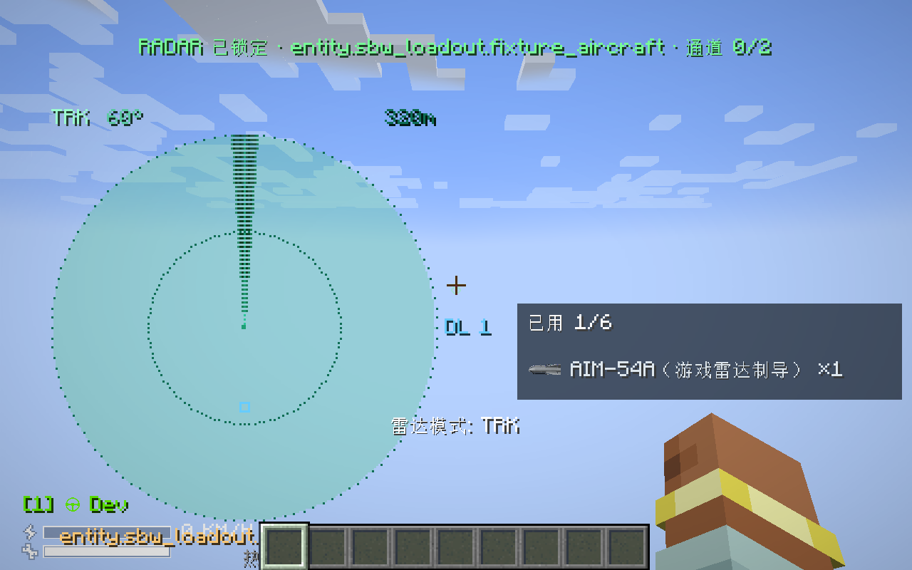
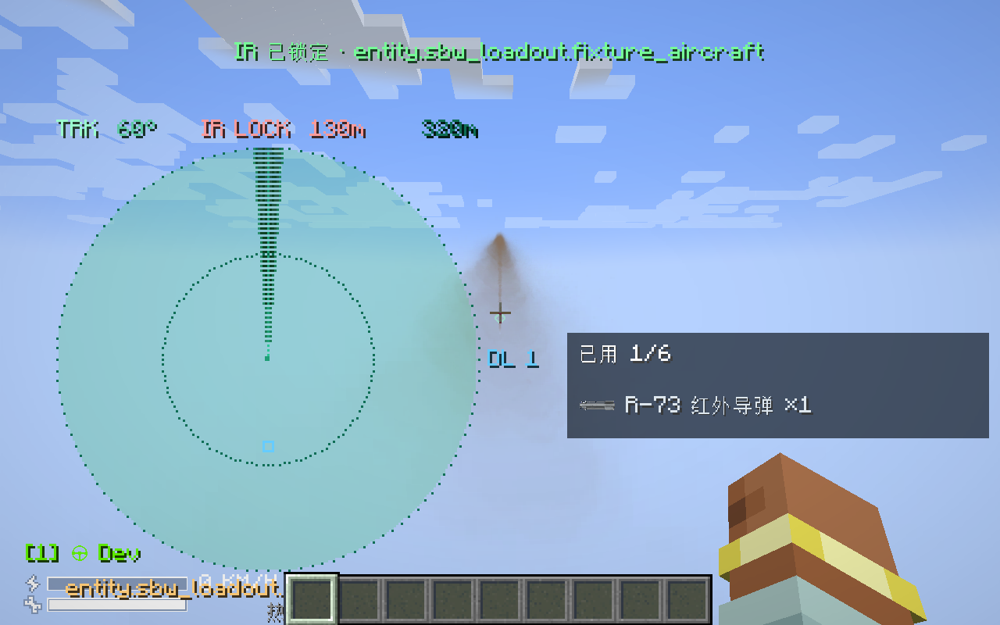

# 空空导弹与雷达模组适配（1.3.4）

日期：2026-10-29。配套版本：**sbw-loadout 1.3.4 + sbw-radar 1.11.1**，MC 1.21.1 / NeoForge 21.1.248，SBW 0.8.9.1 / 0.8.9.2。客户端和服务器同时更新两件 JAR，移出旧版；原有依赖保留。

## 范围

只对下面 10 个空空弹种增加本次空空联动与 50% 爆炸伤害覆盖；原网格、贴图、初速、转向参数、挂点、冷却、锁定射程、直击伤害和爆炸半径保留。弹药分类标记为 `AirToAirMissile`，第三方空空弹可用同一标记进入红外桥接。

| 弹种 ID（sbw_loadout:） | 制导 | 1.3.3 爆炸伤害 | 1.3.4 爆炸伤害 |
|---|---|---:|---:|
| aim54a | 雷达 | 334.62 | 167.31 |
| aim54c | 雷达 | 302.01 | 151.005 |
| pl12 | 雷达 | 65.11 | 32.555 |
| pl12a | 雷达 | 65.11 | 32.555 |
| r40rd | 雷达 | 304 | 152 |
| r40td | 红外 | 304 | 152 |
| r73 | 红外 | 32.94 | 16.47 |
| r73l | 红外 | 32.94 | 16.47 |
| r77 | 雷达 | 86 | 43 |
| r77_1 | 雷达 | 86 | 43 |

Kh-38MT 是空地红外弹，不接入空空红外锁定、登记或削弱；其他空地弹、航弹和巡航弹保留。既有 9M336 雷达弹继续联动，伤害保留 1.3.3 值。原始当量输入保持，覆盖参数写在 `tools/ammo_equivalents.json`；当前全弹种数值见 [弹药伤害与当量](弹药伤害与当量.md)。

## 操作

1. 载具须已声明通用挂载 `Loadout`，`Allowed` 中包含要使用的完整弹药 ID；不会自动修改所有机型的白名单。
2. 雷达弹：O 在 SRC / TWS / TRK 间切换，J 选择 TRK 目标，P 切扫描宽度。TRK 取得有效敌方航迹，或 TWS 已扫描到有效敌方航迹后，按 SBW 原有载具开火键。
3. TWS 优先把新导弹分给尚未占用的航迹；全部已分配时允许在通道限额内再次攻击同一目标。导弹中段保持自己的发射目标，切换新发射目标不会强制改向已发射导弹；进入独立末段或被箔条诱骗后释放照射通道。
4. 红外弹：对准可见热目标，出现 IR 锁定提示后开火；无需 TRK，不占用雷达照射通道。有效范围取红外模组的前/后向规则、视锥和本弹种自身限制的交集，障碍物会阻断锁定。
5. G 热诱弹、H 箔条，消耗载具储物空间中的原生热诱弹 superbwarfare:flying_flare_ammo 或箔条 sbw_radar:chaff；载具须支持原生诱饵。箔条作用于雷达弹，热诱弹作用于红外弹；继续采用雷达模组的概率、距离和库存规则。不能用自己的干扰弹使自己的齐射脱锁。

已有 `options.txt` 可能保留旧雷达 K / L 键，请在控制设置中改为 O / P；不自动覆盖用户改键。机腹吊舱的 K 锁定、L 激光、Shift+K 热成像保留。

**敌我识别遵循 SBW：无队伍驾驶员的载具会被列为中立雷达目标。** 中立点可显示，但不授予雷达空空弹发射许可；测试和对战应正确设置敌我队伍。SRC、过期航迹、同队、遮挡、射界外或满通道时拒绝发射，不扣弹。客户端发送的目标 UUID 不能覆盖服务端雷达/红外锁定。

## 接口与边界

- 雷达模组通过可选 `RadarLink.Provider` 注册联动，挂载模组不依赖雷达类。未安装雷达时保留既有独立锁定/原生红外流程；同装时最低版本由可选依赖约束检查。
- `launchTarget` 用于本次新发射选择；`trackedTarget` 用于已发射导弹的固定航迹。旧 Provider 只实现 `lockedTarget` 仍可编译工作。
- 红外桥接先在服务端重新校验热目标，再登记挂载已经发出的原弹体；不另造导弹、不另扣弹、不改变 Kh-38MT 的原生空地流程。登记标记和热诱脱锁状态随实体存档恢复。
- 照射通道合计雷达模组自身弹体与挂载雷达弹的中段占用，受弹种上限和雷达配置上限共同约束。HUD 显示同一占用值；红外弹不计入雷达通道。
- 已声明挂载的飞机即使有原生 `Radar` 数据，也能运行雷达附属火控；雷达附属 HUD 优先显示本机附属火控源。机载雷达仍受 `airborne.enable`、扫描范围、宽度及高度窗口约束。
- 保留雷达 1.11.0 的分体式防空、自主发射及原因提示。已接管挂载的飞机/直升机保持驾驶员手动发射，不进入该地面防空自主发射流程；原生远程发射 API 也不能绕过其挂载库存。无玩家 UUID 的自主地面弹体末段检查会安全处理。
- 联动近炸使用本弹体 SBW 爆炸伤害与半径，避免另造原版爆炸绕过 50% 平衡。引信半径受雷达配置与弹体爆炸半径约束；不会因自机、其乘员、友军、地面/遮挡目标或已经被干扰的联动弹体自动起爆。直接碰撞仍沿用原生 SBW 规则。
- 不声明真实武器性能，也不把游戏视锥、末段搜索或转向限制等同于现实火控。不会加载新的远端区块来强制取得目标。

## 构建

先准备 [本地依赖](../libs/README.md)，两个仓库放在同级 `sbw_loadout` / `sbw_radar`：

```powershell
# 在 sbw_loadout 中；JDK 21
.\gradlew.bat clean build exportCompileClasspath
.\gradlew.bat -p ..\sbw_radar '-PsharedClasspathFile=../sbw_loadout/build/radar-compile-classpath.txt' clean build
.\gradlew.bat -Pgametest -PradarCompat '-PtestWorld=air_compat_891' runGameTestServer
.\gradlew.bat -Pgametest -PradarCompat '-PsbwVersion=0.8.9.2' '-PtestWorld=air_compat_892' runGameTestServer
.\gradlew.bat -Pgametest -PradarCompat -Pairsmoke runClient
.\gradlew.bat -Pgametest -PradarCompat -Pairsmoke '-PsbwVersion=0.8.9.2' runClient
.\gradlew.bat clean build
```

`testWorld` 指定开发验证世界名，放在忽略的 `validation/test-worlds/`；再次运行可换新名字，避免误用被先前测试改动过的世界。`radarCompat` 和 `airsmoke` 是开发开关，发布前最后一次构建不带这些参数。雷达普通离线编译方式仍保留；共享类路径方式只复用开发依赖，不将依赖打入雷达 JAR。

## 验收

最终服务端/客户端结果、两件正式 JAR 的大小和 SHA256、模型字节校验见 [release-checks-1.3.4.json](release-checks-1.3.4.json)。完整最终日志随 Release 验收附件提供。

新增服务端用例覆盖 10 种实际弹体及减半伤害、空地红外排除、伪造目标拒绝、单次扣弹/单次登记、真实 TRK 扫描、TWS 分配和通道满载、过期航迹、原生雷达载具、红外开关、箔条/热诱分类、重载后脱锁，以及联动近炸。原挂载、航弹散布、电视/激光、热成像和低空巡航用例继续回归。

夹具批次结束清理残留实体，测试弹体保留伤害数值但关闭地形破坏，防止后续测试结构被残弹炸毁；这部分位于开发源集，不进入生产 JAR。客户端验收使用隔离平地世界，测试场景将弹体杀伤置零，只检查实际网络路径、状态和模型渲染；伤害值由服务端实际发射测试与正式包审计核对。




