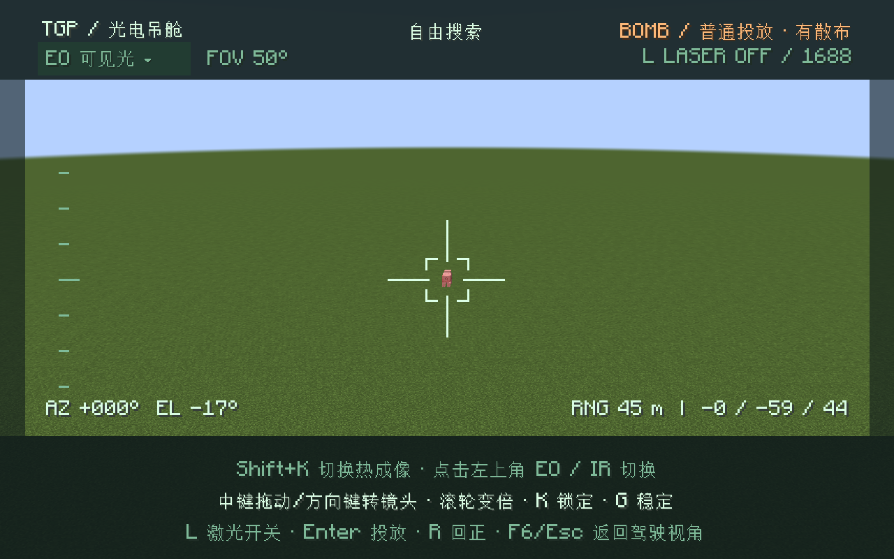
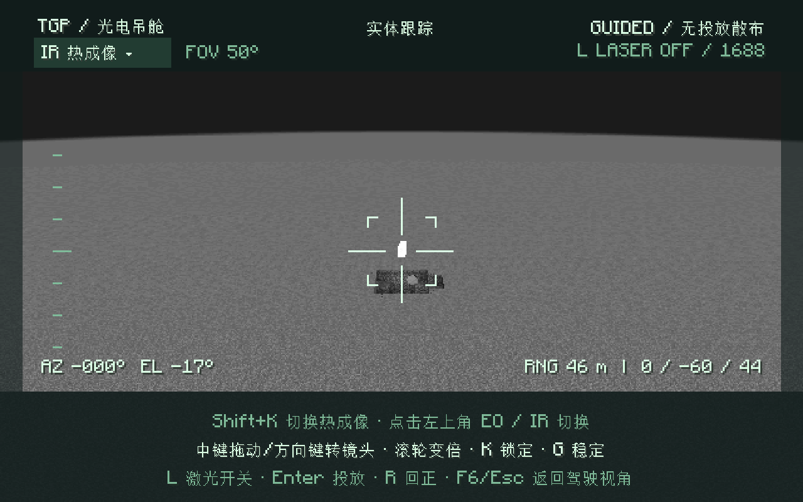

# 1.3.3 验收记录

发布日期：2026-10-27。构建环境为 JDK 21、Minecraft 1.21.1、NeoForge 21.1.248。

| SBW 版本 | 服务端 GameTest | 真实客户端检查 | 未锁定释放样本 | 锁定释放样本 |
|---|---:|---:|---:|---:|
| 0.8.9.1 | 60/60 | 10/10 | 32 | 16 |
| 0.8.9.2 | 60/60 | 10/10 | 32 | 16 |

服务端覆盖全部 11 种航弹未锁定投放、随机初始速度、飞机速度继承、锁定后零附加初始误差、TV 失效目标、激光编码/照射失效、坐标显式锁定、固定坐标不跟随实体、普通炸弹不获制导，以及原有挂载、制导、雷达与巡航测试。航弹用例使用独立批次，避免改变其他雷达测试的候选目标场景。

客户端覆盖 F6 进入、状态同步、两种投放模式的实际发射、完整模型渲染、热成像下的制导提示、解锁与返回驾驶视角。这里验证的是本次释放规则，不把零投放误差等同于所有情况下必定命中。

## 实际游戏画面

未锁定航弹可以普通投放，界面显示有散布：

锁定后在热成像下显示无投放散布：

## 正式文件

- 下载：[v1.3.3 Release](https://github.com/zzy25565/sbw-loadout/releases/tag/v1.3.3)
- 文件：`sbw-loadout-1.3.3.jar`
- 大小：91,287,919 字节
- SHA256：`df88401b44006d2fb47e400ba3f15e54fa2fecf423b9bb25bb0281434a8ad857`
- 网络协议：5；客户端与服务端都安装同版 JAR。

无测试参数的 `clean build` 成功，正式 JAR 不包含开发测试类、测试弹种或测试载具。全部 29 份弹药定义和 140 份模型/贴图/数据资源与 1.3.2 正式包逐字节一致；低空巡航、雷达导引、基础导引及热成像控制器字节保持一致。

机器可读校验见 [release-checks-1.3.3.json](release-checks-1.3.3.json)，完整日志随 Release 的验收附件提供。
